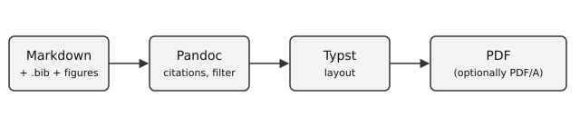
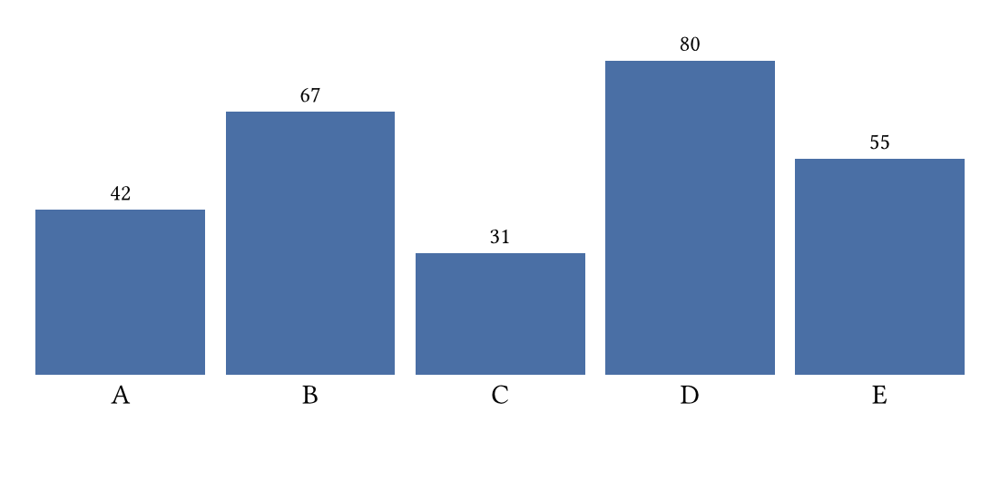

# Introduction {#sec:intro}

A document that is built from plain text can be versioned, reviewed and rebuilt at any
time. Literate and reproducible workflows have long argued for keeping the source of a
document and its product together [@knuth1984; @sandve2013, pp. 2--3]. The same idea
applies to a thesis: the Markdown file is the thesis, and the PDF is a product that can
be regenerated whenever needed.

This chapter introduces the example. @sec:writing explains how to write text, @sec:figures
shows figures, tables and equations, and @sec:config explains the configuration.

## What is built {#sec:built}

The build runs the same steps every time. @fig:pipeline gives an overview.

{#fig:pipeline width=100%}

Data should be findable and reusable, which is the point of the FAIR principles
[@wilkinson2016]. The bibliography below is generated only from the sources that are
actually cited in the text.

# Writing in Markdown {#sec:writing}

Use normal Markdown: *emphasis*, **strong text**, `inline code`, lists, quotes and
footnotes.[^note] A source is cited by its key from the `.bib` file, for example
[@knuth1984]. A citation can have a page locator, [@sandve2013, p. 4], and several
sources can be combined, [@knuth1984; @wilkinson2016]. When the author is part of the
sentence, write @wilkinson2016 directly.

[^note]: Footnotes are numbered automatically and placed at the bottom of the page.

> A block quote is set off from the surrounding text.

Lists work as usual:

1. Write the text in Markdown.
2. Keep the bibliography in Zotero and export it as a `.bib` file.
3. Run the build.

A code block keeps its formatting:

```bash
make pdf
```

# Figures, tables and equations {#sec:figures}

Figures are plain image files (PNG, JPG or SVG). They are never generated during the
build, so even very long analyses do not slow it down: create the image once and commit it.
@fig:chart is a PNG file.

{#fig:chart width=70%}

Tables are written in Markdown and can be referenced as well; see @tbl:profiles.

| Profile | Title page | Contents | Chapters on new page |
|:--------|:----------:|:--------:|:--------------------:|
| thesis  | yes        | yes      | yes                  |
| report  | yes        | yes      | no                   |
| article | no         | no       | no                   |

: The built-in profiles. {#tbl:profiles}

Equations are written in TeX notation. The arithmetic mean is defined in @eq:mean.

$$ \bar{x} = \frac{1}{n} \sum_{i=1}^{n} x_i $$ {#eq:mean}

Inline mathematics such as $a^2 + b^2 = c^2$ needs no label.

# Configuration {#sec:config}

Settings live in `paperplate.yaml`; the content of the title page, the abstract and the
other texts live in the YAML front matter at the top of this file. Switching the
citation style is a one-line change (`csl: ieee`), as is choosing a different profile
(`profile: article`) or turning pages on and off (`declaration: true`, `lof: false`).

# Conclusion {#sec:conclusion}

A thesis written this way is easy to rebuild, review and archive. Everything that
influences the output is in the repository, and the tool versions are pinned.

# Appendix {.unnumbered}

Unnumbered headings are used for appendices and similar sections.
